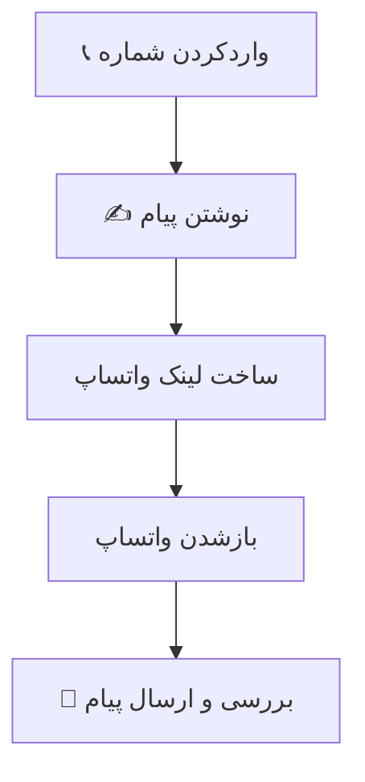

# 💬 WhatsApp Direct

  <strong>ارسال پیام در واتساپ، بدون ذخیره‌کردن شماره</strong>
   
  شماره و متن پیام را وارد کن و مستقیم به صفحه‌ی گفت‌وگوی واتساپ برو.

  
  

---

## 📱 درباره‌ی برنامه

**WhatsApp Direct** یک ابزار ساده برای آماده‌کردن پیام واتساپ با استفاده از شماره تلفن است. لازم نیست برای شروع گفت‌وگو، شماره را ابتدا در مخاطبین ذخیره کنی.

## 🧭 مسیر کار

## ✨ امکانات

- واردکردن شماره‌ی مقصد
- نوشتن متن پیام دلخواه
- آماده‌سازی متن برای استفاده در لینک واتساپ
- هدایت به اپلیکیشن واتساپ برای ادامه‌ی گفت‌وگو

## 🔎 نکته

برنامه پیام را برای کاربر آماده می‌کند و واتساپ را باز می‌کند؛ ارسال نهایی پیام در خود واتساپ انجام می‌شود.

---

  <strong>یک شماره، یک پیام، بدون افزودن مخاطب.</strong>

